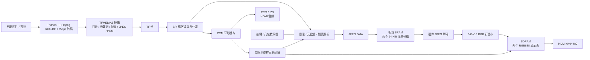

# TF 卡 JPEG 音视频播放器 · 霁泽入微工作室

基于安路 **EG4S20BG256** 板卡，使用自定义 **TFMEDIA3 裸卡文件系统**，通过 SPI 读取 TF 卡，在 FPGA 中完成 JPEG 解码、PCM 音频输出和 HDMI 显示。媒体规格为 **640×480、25 fps**，支持图片轮播、视频自动切换、手动切换和暂停。

当前实板验收固件为 [08_player_avsync.bit](firmware/08_player_avsync.bit)。本文档描述整理后的独立工程；历史调试过程见 [验证记录](docs/history/验证结果.md)。

当前扩展固件：[10_player_picture_blend.bit](firmware/10_player_picture_blend.bit)，包含图片交叉渐变、左下角暂停标志，以及 SW0 音量、SW1 亮度、SW2 对比度、SW3 彩色文字与 SW4 音频波形。已通过专项仿真与最终时序检查，尚待实板验收；[固件说明](firmware/README.md) 提供资源、报告和校验清单。

## 解压或 Git 拉取后开始使用

运行环境为 Windows 10/11 x64、Windows PowerShell 5.1 或更新版本。包内已提供 Python 3.12.10、Pillow 11.3.0、FFmpeg 和 Icarus 的离线依赖；无需系统 Python、pip，也不需要旧工程目录。

1. 将整个目录解压到本地，或 `git clone https://github.com/soutiuking/fpga-s-hdmi-output.git useing` 后进入目录。
2. 双击 `setup.cmd`，离线检查依赖 SHA256 并解包工具。也可以直接运行 `media.cmd`，首次会自动初始化。
3. 使用 TD 下载 `firmware/10_player_picture_blend.bit` 体验扩展功能；需要实板已验收基线时选择 `firmware/08_player_avsync.bit`。已有 TF 卡可以继续使用。
4. 制作新卡时双击 `media.cmd`，或使用下面的命令。板上 **S0：下一媒体；S1：暂停/继续；RESET：重新初始化**。

重新编译需要另行安装 **Anlogic TD 6.2.168116** 及其器件库、许可和下载器驱动；这些厂商工具不包含在本包中。仓库及压缩包提供相同的源码、必要依赖和验收固件，无需 Git LFS 或子模块。

源码已新增 **SW0 音量设置、SW1 亮度设置**：拨下对应开关后，S0 增加、S1 减少，屏幕下方显示带扬声器/太阳图标的平滑动画条；亮度使用灰色槽和琥珀金填充。拨回后隐藏动画条，保留设置并恢复切换/暂停功能。两开关同时开启时优先音量；设置在本次通电期间保持，RESET 或断电后恢复默认。SW5～SW7 预留；需使用 09 或更新固件，原 `08_player_avsync.bit` 不含这些功能。详见 [拨码开关与音量](docs/拨码开关与音量.md)。

**SW2 对比度设置**也已接入：S0 增加、S1 减少，0～16 档，默认 8 档保持原始对比度。灰色底槽配淡紫色动画条，拨回后保留设置。多个开关同时开启时优先级为 SW0 > SW1 > SW2；当前剩余 SW5～SW7 预留。

**SW3 彩色滚动文字**：图片或视频播放时拨下 SW3，在屏幕上方从右向左循环显示“fpga真有意思，真好玩”，汉字随时间循环变色；拨回后隐藏。SW3 独立控制，可与设置条同时显示，不占用 S0/S1。详见 [SW3 滚动文字](docs/SW3滚动文字.md)。

**SW4 音频波形**：拨下 SW4，在画面左侧叠加实际输出音频的青绿色振幅包络，随声音实时变化；拨回隐藏。显示最近约 0.53 秒的左声道振幅变化，跟随音量，静音呈水平线。可与视频、滚动文字和设置条同时显示，不占用按键，不增加 DSP 或块 RAM。当前仅 SW5～SW7 预留。详见 [SW4 音频波形](docs/SW4音频波形.md)。

**图片交叉渐变与暂停标志**：仅图片切图片时自动交叉融合，视频逐帧播放和图片/视频互切保持直接换页；视频暂停显示青色 `Ⅱ`，图片停止轮播显示金色图片＋`Ⅱ`，均在左下角，恢复后隐藏。详见 [功能说明](docs/图片交叉渐变与暂停标志.md)。

当前剩余资源与 SW5～SW7 的后续功能建议见 [资源与扩展建议](docs/资源与扩展建议.md)。

```powershell
# 在工程根目录执行；双击入口和命令行入口共用同一套离线工具。
.\setup.cmd
.\media.cmd pack .\demo\color_bars.png .\demo\source_test.mkv --audio -o .\output\my_card.img
.\media.cmd inspect .\output\my_card.img
.\test.cmd
.\build.cmd -Target TFMEDIA3_Player -TdRoot 'E:\ANLU-TD'
```

若 TD 已加入 PATH 或配置了 `TD_ROOT`，可省略 `-TdRoot`。请参阅 [TD 编译与迁移](docs/TD编译与迁移.md)。

## 系统架构分析



### 为什么采用自定义文件系统

电脑提前完成缩放、帧率转换、压缩、扇区布局和索引构建。TF 卡不使用 FAT 簇链，FPGA 无需处理通用文件打开、目录递归或文件碎片：读超级块和顺序目录后，使用 `<offset,size>` 帧表直接定位 JPEG。每个视频帧独立压缩，可以跳到指定帧，避免顺序解析整段视频。

TFMEDIA3 使用 512 字节扇区，LBA 0 为带 CRC32 的超级块，LBA 1 为目录，最多 20 个媒体条目；脚本限制最多 10 张图片和 10 段视频。每个条目包含元数据、连续帧表、连续 JPEG 数据和可选 PCM。超级块及元数据 CRC32 用于校验结构，详细字段见 [卡格式](docs/TFMEDIA3_FORMAT.md)。镜像必须写入物理盘起始位置，不能作为普通文件复制到卡里。

### FPGA 数据通路和缓存职责

| 环节 | 作用与边界 |
|---|---|
| SPI + 扇区仲裁 | 协调目录、帧表、JPEG DMA 和音频请求，避免多路同时占用 TF 卡 |
| 两个 SRAM 压缩帧槽 | 单槽最多 64 KiB，允许读取下一帧和解码当前帧重叠 |
| JPEG 核 | baseline、8 bit、YCbCr 4:2:0、标准 Huffman 表；不支持 progressive、自定义 Huffman、restart interval 或多扫描 |
| 640×16 行缓存 | 将 JPEG MCU 块输出转换为光栅顺序，减少片上存储占用 |
| 两个 SDRAM 显示页 | 完整帧写完后才提交；显示域在场边界换页并确认，防止显示半帧或覆盖正在显示的页 |
| PCM 环形缓存 | 48 kHz、单声道、16 bit PCM；独立预取，消费计数用于视频调度 |
| 数码管 | 显示错误、解码阶段、帧号和媒体状态；配置 4 已实板确认八位顺序 |

参考时钟为板载 50 MHz；读卡/JPEG 为 40 MHz，SDRAM 为 125 MHz，HDMI 像素钟为 25 MHz，HDMI 刷新约 59.52 Hz。各时钟域使用同步释放复位和帧页握手。管脚约束位于 `user_source/constraints_source/`，板卡资料位于 [docs/hardware](docs/hardware/)。

### 08 版音画同步

第一帧实际显示确认后才开启音频。有音轨时，每 **1920 个实际消费的 PCM 样本**推进一个视频帧；提前完成的帧等待时间轴，落后多于一帧的预读压缩帧可直接跳到当前进度附近。无音轨视频使用 40 ms 时间基准。暂停冻结新的 PCM 消费和显示提交，已经在途的末样本仍计数，避免结束状态卡住。

这种调度避免音频持续播放而视频延迟不断累积。TF 卡吞吐或 JPEG 解码来不及时会跳过过期帧，实际显示帧数可能少于 25 帧/秒。25 fps 是媒体和调度目标，尚未进行实板帧率及音画偏差的定量测量。详见 [音画同步设计](docs/音画同步.md)。

## 工程目录

| 路径 | 内容 | Git |
|---|---|---|
| `td_project/*.al`、`al_ip/` | 三个 TD 工程和必要 IP 配置/封装 | 管理 |
| `user_source/` | HDL、板卡管脚和时序约束、厂家 IP 配套源文件 | 管理 |
| `third_party/core_jpeg/` | JPEG 解码核、Apache-2.0 许可和本地修改说明 | 管理 |
| `tools/` | 写卡工具、离线初始化、TD 流程脚本、仿真及打包入口 | 管理 |
| `vendor/` | 离线依赖压缩包、wheel 和 SHA256 清单 | 管理 |
| `firmware/` | 测试固件、08 实板基线、09/10 扩展版及校验清单 | 管理 |
| `sim/` | RTL 测试、真实缺陷回归样本 | 管理 |
| `demo/` | 彩条、两秒示例视频及预生成测试镜像 | 管理 |
| `docs/` | 测试流程、迁移、写卡、Git、板卡资料及精选验证证据 | 管理 |
| `.runtime/` | 初始化解出的可执行环境 | 忽略 |
| `build/`、`output/` | 各次 TD 编译产物、用户生成镜像 | 忽略 |
| `dist/`、`media/` | 本地压缩包和自行放入的原始素材 | 忽略 |

`firmware/08_player_avsync.bit` 是固定验收基线，SHA256 为：

```text
D720296B1BC6D058DE31C581583C3561C512D416F46B9E987CDA86B5777E14D6
```

每次编译产生独立的带时间戳目录，不覆盖验收基线，不提供自动清理脚本。未复制的历史缓存仍保留在原目录；整理过程不删除原有文件。
新工作目录中保留但不随 Git/ZIP 分发的参考文件，见 [本地保留文件说明](docs/本地保留文件.md)，可由用户自行决定如何处理。

## 测试、写卡和版本管理

- [完整测试流程与结果记录模板](docs/测试流程.md)：离线检查、RTL 回归、分阶段上板、长视频与故障定位。
- [写卡工具使用](tools/README.md)：图片、视频、音轨、磁盘选择和全量回读。
- [TD 编译与迁移](docs/TD编译与迁移.md)：GUI、命令行、版本、seed 及输出位置。
- [Git 管理与发布](docs/Git管理与发布.md)：提交、远程仓库配置、干净克隆和压缩包。
- [版本记录](CHANGELOG.md)、[09 工程标准化验证](docs/09工程标准化验证.md)、[固件与校验清单](firmware/README.md)。
- [数码管调试](docs/数码管测试.md)、[交付验证](docs/交付验证.md)、[历史验证](docs/history/验证结果.md)。

首次使用测试镜像 `demo/bringup.img`：彩条静态图约 3 秒，再播放两秒测试视频，循环。制作带声音的自有素材时请显式传 `--audio`，默认不保存音轨。

## 来源与署名

项目整理及系统实现：**霁泽入微工作室**。

参考厂家 `lab_ex5_i2s` 示例中的 HDMI、SDRAM、SPI 和安路器件 IP；这些文件保留原始署名和声明。JPEG 核来源于 [ultraembedded/core_jpeg](https://github.com/ultraembedded/core_jpeg)，具体修改见 [LOCAL_CHANGES.md](third_party/core_jpeg/LOCAL_CHANGES.md)。离线工具来源、版本及校验值见 [依赖说明](vendor/README.md) 和 `vendor/manifest.json`，各组件沿用自身许可。本项目署名不改变第三方文件权利。
